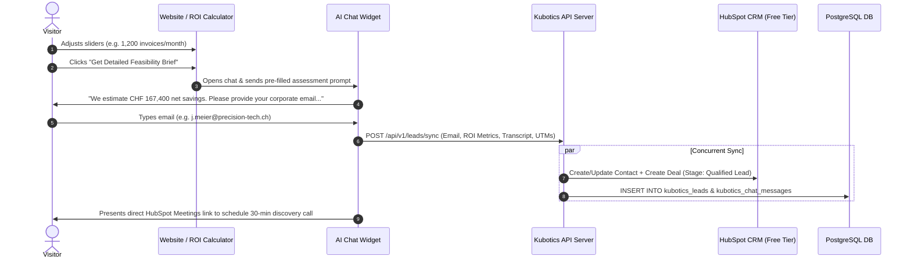
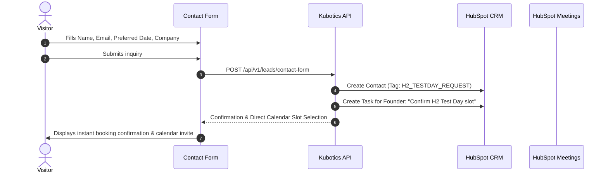

# Kubotics CTA Strategy & Conversion Flows

This document details every Call To Action (CTA) on the Kubotics website, its user intent, conversion goal, and the end-to-end automated workflow connected to our backend, PostgreSQL database, and HubSpot CRM.

---

## 1. Global CTA Inventory & Conversion Paths

| # | CTA Text (DE / EN) | Placement | Target Action | HubSpot CRM Flow |
|---|---|---|---|---|
| **CTA-1** | `UNITREE H2 TESTTAG BUCHEN` / `BOOK UNITREE H2 TEST DAY` | Hero Section (Accent Button) | Scrolls to Contact Form + Preselects "Unitree H2 Test Day" | Creates Contact (`hs_lead_status: 'NEW'`), pipeline stage `Appointment Scheduled`, sets property `kubotics_primary_interest: 'Humanoid'` |
| **CTA-2** | `LÖSUNGEN ERKUNDEN` / `EXPLORE SOLUTIONS` | Hero Section (Primary) | Smooth scroll to `#solutions` | Top-of-funnel engagement tracking (`event: 'explore_solutions_clicked'`) |
| **CTA-3** | `ROBOTER & TECH` / `ROBOTICS & TECH` | Hero Section (Secondary) | Smooth scroll to `#technology` | Middle-of-funnel consideration tracking |
| **CTA-4** | `INDIVIDUELLE ANFRAGE` / `CUSTOM REQUEST` | Solutions Section Header | Scrolls to `#contact` with custom request flag | Captures custom robotics cell & arm inquiries |
| **CTA-5** | `Detaillierten Machbarkeitsbericht anfordern` / `Get Detailed Feasibility Brief` | ROI Calculator Card | Opens AI Chatbot with calculated parameters pre-filled | AI Agent automatically parses savings/volume, requests company email, syncs to HubSpot with `kubotics_qualification_score` |
| **CTA-6** | `Testtag / Beratungsgespräch buchen` / `Book Test Day / Discovery Call` | ROI Calculator Card | Scrolls to `#contact` / Direct Calendar Booking | Direct redirection or prompt to select date for live demo in Switzerland |
| **CTA-7** | `AI Specialist` / Floating Assistant Trigger | Bottom-Right Floating Widget | Opens interactive conversational qualification agent | Real-time chat session saved to `kubotics_chat_sessions`, captures email & phone, syncs with HubSpot Contacts & Deals |
| **CTA-8** | `Beratungs- & Testtag buchen` / `Book a Consulting & Test Day` | Unitree H2 Tech Card | Jumps to `#contact` with H2 focus | Direct H2 lead tag in CRM |
| **CTA-9** | `NACHRICHT SENDEN` / `SEND MESSAGE` | Contact Form Submit | Submits full enquiry form | Dispatches confirmation email, inserts lead into PostgreSQL, triggers HubSpot Contact creation |

---

## 2. Detailed Automated Flows per Key CTA

### Flow A: ROI Calculator $\rightarrow$ AI Agent Feasibility Brief (CTA-5)

### Flow B: Unitree H2 Test Day Direct Booking (CTA-1 & CTA-8)

---

## 3. HubSpot CRM Integration Architecture (via REST API v3)

### How It Works:
Because Kubotics uses a modern Angular SSR frontend + PostgreSQL backend, the integration will **not rely on slow third-party client widgets** which hurt Core Web Vitals and SEO. Instead, it utilizes **secure server-side REST API calls** to HubSpot v3:

1. **Authentication**:
   - A Private App Token (`HUBSPOT_ACCESS_TOKEN`) generated from the free HubSpot account is stored in the server environment variables (`.env`).
   - The token never leaks to the client browser.

2. **Endpoints Used**:
   - `POST https://api.hubapi.com/crm/v3/objects/contacts`:
     - Creates or updates contacts based on email deduplication.
     - Maps: `firstname`, `lastname`, `email`, `phone`, `company`, `message`, `hs_lead_status`, `lifecyclestage: "lead"`.
   - `POST https://api.hubapi.com/crm/v3/objects/deals`:
     - Creates an automated deal in the default sales pipeline under "Appointment Scheduled" or "Qualified to Buy".
   - `POST https://api.hubapi.com/crm/v3/associations/contacts/deals/batch/create`:
     - Links the deal to the corresponding contact.

3. **UTM Attribution**:
   - The frontend automatically captures `utm_source`, `utm_medium`, `utm_campaign`, and `gclid` (Google Ads Click ID) from the visitor's landing URL.
   - These are passed into HubSpot standard contact properties (`utm_source`, `hs_google_click_id`), enabling precise Google Ads ROI calculation inside HubSpot.
