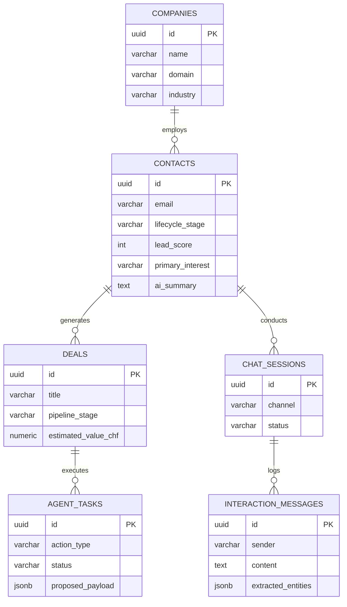

# PostgreSQL as the Autonomous CRM & Agentic Architecture

## 1. Executive Analysis: Why Drop External SaaS CRM (HubSpot)?
Your intuition directly aligns with **Guiding Principle #5 & #6** of your Business & Tech Plan:
> **"5. Use PostgreSQL wherever possible."**  
> **"6. Avoid unnecessary SaaS subscriptions."**  
> **"1. Founder time is more expensive than cloud compute."**

### Strategic Comparison: PostgreSQL vs. HubSpot

| Evaluation Vector | External SaaS CRM (HubSpot) | Native PostgreSQL Schema |
|---|---|---|
| **Agentic Access & Read/Write** | ❌ Complex REST API rate limits, OAuth token refresh, rigid schemas | ✅ Direct, instant SQL/pgvector queries, low latency (< 2ms) |
| **Data Siloing** | ❌ Customer data split between HubSpot, Website logs, and your backend | ✅ **Single source of truth**: all channels (Web chat, Email, Phone/Voice, Proposals) share identical state |
| **LLM Context Injection** | ❌ Requires custom sync pipelines, webhook webhooks, and serialization | ✅ Trivial `SELECT * FROM contacts JOIN interaction_messages...` to feed LLM agent system prompts |
| **Cost & Scaling** | ❌ Escalates rapidly into hundreds/thousands per month as contacts grow | ✅ CHF 0 incremental cost on your existing managed PostgreSQL |
| **Founder UI Overhead** | ❌ Heavy commercial UI with excessive menus and setup | ✅ Lightweight founder review table / minimal dashboard or CLI |

---

## 2. Relational Architecture for Autonomous Operations

---

## 3. How the Autonomous Agent Uses PostgreSQL

1. **Inbound Qualification**:
   - The web chat / voice / email agent writes visitor messages to `interaction_messages`.
   - The LLM extracts key parameters (e.g. `monthly_invoices: 1200`, `interest: "Unitree H2 Test Day"`, `company: "Bühler"`) into `extracted_entities`.
2. **Contact & Deal Auto-Creation**:
   - The agent upserts the `contacts` record and opens a record in `deals` (e.g. `pipeline_stage: 'testday_scheduled'`).
3. **Founder-in-the-Loop Safeguard (`agent_tasks`)**:
   - When an agent wants to perform an action (e.g., dispatch a binding pricing proposal or confirm a calendar slot), it inserts a task into `agent_tasks` with `status: 'pending_approval'`.
   - The founder gets a 1-click notification (Email or Telegram/Slack bot) to approve or modify.

The complete executable schema is saved in [`src/server/schema.sql`](file:///home/vincent/Coding/Websites/Kubotics/src/server/schema.sql).
