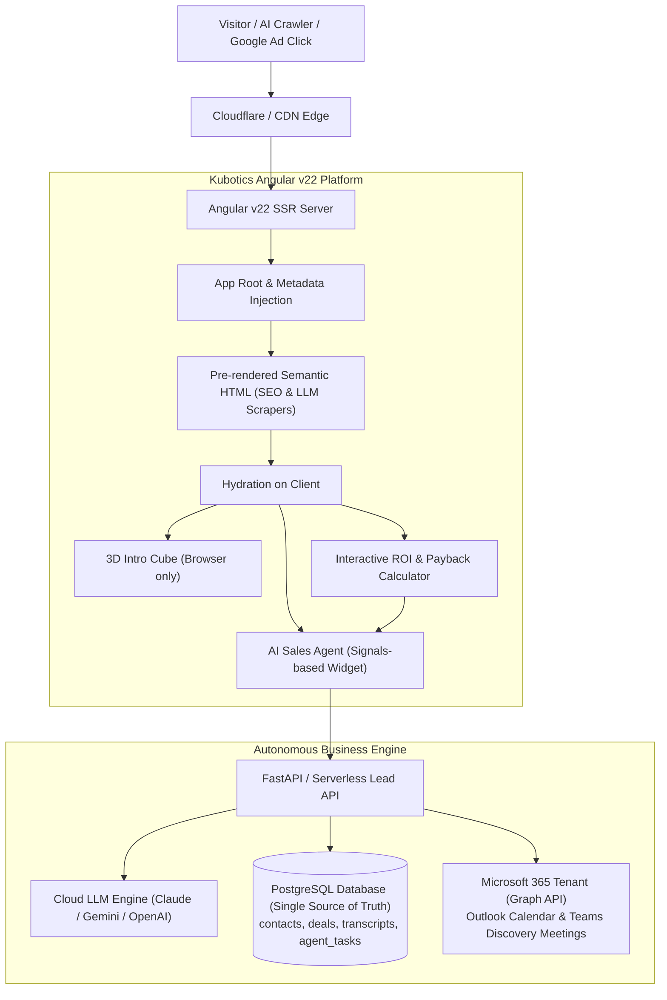

# Kubotics Website Redesign & Modernization Plan

## 1. Executive Summary & Strategic Alignment
Based on the **Kubotics & KuroLIV AI-First Business & Technology Plan** and current business objectives:
- **Core Goal**: Transform the Kubotics website into a high-converting, authority-building platform designed for **AI Search engines (GEO - Generative Engine Optimization)**, **Google Ads / Google Search**, and **automated inbound lead qualification**.
- **Tech Stack Upgrade**: Upgrade to **Angular v22 (v22.2.x)** with full **Angular SSR (Server-Side Rendering)** / Hydration.
- **Data & Pipeline Engine**: Direct integration with a centralized **PostgreSQL** schema (single source of truth for leads, company dossiers, pipeline stages, conversation transcripts, and agent tasks).
- **Calendar & Meeting Scheduling**: Native integration with our existing **Microsoft 365 Tenant (Outlook / Microsoft Graph API / M365 Bookings)**.
- **AI Agent Integration**: Embedded interactive, automated sales/qualification chat agent with instant qualification flows for Unitree H2 Test Days, Robot Arms/Cells, and Multimodal LLM Invoice Processing.

---

## 2. Strategic Decision: Why Drop HubSpot in Favor of PostgreSQL + M365?

During architectural review, we evaluated whether to incorporate an external SaaS CRM (HubSpot Free tier) or build directly upon our native PostgreSQL DB and Microsoft 365 tenant. We chose to **drop HubSpot entirely** based on fundamental AI-first architectural principles:

### 1. Alignment with Core Business Plan Guiding Principles
- **Guiding Principle #5**: *"Use PostgreSQL wherever possible."*
- **Guiding Principle #6**: *"Avoid unnecessary SaaS subscriptions."*
- **Guiding Principle #1**: *"Founder time is more expensive than cloud compute."*
- HubSpot is designed for human sales representatives clicking through extensive enterprise web interfaces. In an AI-first operating model, our primary users of CRM data are **autonomous AI agents** (chat, email, phone/voice, proposal-generators) and the founder.

### 2. Zero-Latency, Native Context for AI Agents
- **API vs. Direct SQL**: Syncing to HubSpot introduces external REST API rate limits, OAuth token management, and payload serialization delays. 
- **Low Latency (< 2ms)**: By storing leads, transcripts, and pipeline stages in PostgreSQL, our agents can perform immediate SQL/pgvector queries, extract conversational context, and make real-time qualification decisions without external network hops.

### 3. Elimination of Data Silos (Single Source of Truth)
- With HubSpot, customer data inevitably becomes fragmented: raw transcripts and token logs in PostgreSQL, contact details and deals in HubSpot, calendar slots in another tool.
- A native PostgreSQL schema (`companies`, `contacts`, `deals`, `chat_sessions`, `interaction_messages`, `agent_tasks`) ensures **one single source of truth** shared identically across web chat, email agents, voice SIP agents, and internal analytical queries.

### 4. Meeting Scheduling via Existing M365 Tenant
- Rather than maintaining an extra external booking widget (HubSpot Meetings / Calendly), we utilize our existing **Microsoft 365 Tenant**:
  - Direct integration with Outlook Calendar and Teams via the **Microsoft Graph API**.
  - Direct booking links via **M365 Bookings / Book With Me** (`outlook.office.com/bookwithme/...`).
  - Automated Teams meeting link generation, zero additional tool cost, and native enterprise calendar sync.

### 5. Human-in-the-Loop Governance (`agent_tasks` table)
- Guiding Principle #8 mandates *"Human approval for consequential actions"*.
- Instead of complex HubSpot workflow automations, our agents record pending actions (e.g. sending binding proposals, confirming custom dates) into an `agent_tasks` queue with `status = 'pending_approval'`. The founder can approve or modify these with a simple 1-click notification.

---

## 3. Critical Review of Current Site & Intro Cube

### Strengths Preserved
- **Interactive 3D Intro (`IntroCubeComponent` / Three.js)**: Delivers an unmistakable high-tech, cybernetic impression of Swiss robotic precision.
- **Apple-Industrial Aesthetics**: Dark theme, high-contrast typography, and precision engineering badges.

### UX & SEO Shortcomings Addressed
1. **SSR & Three.js Conflict Resolved**:
   - Three.js requires browser WebGL contexts. We isolated canvas initialization using `isPlatformBrowser(this.platformId)`, allowing instant Node SSR prerendering for search engine and AI crawlers without runtime crashes.
2. **Instant Crawler Indexing & Returning User Bypass**:
   - The semantic `<main>` HTML is immediately available in the SSR payload. Human browser visits retain the visual 3D cube on first visit, while `sessionStorage` bypasses it on repeat visits.
3. **From "Robotics Showcase" to "AI Automation Sales Platform"**:
   - Expanded beyond a single test-day landing page into a full solution platform:
     1. Unitree Robotics Delivery & Commissioning (H2 flagship, G1, B2 quadruped).
     2. Custom Factory Automation & Robot Arms (CNC machine tending, pick & place).
     3. IT Business Process Automation (Resource planning, ERP dispatch).
     4. Multimodal LLM Invoicing (Reliable extraction from low-grade scans and crumpled receipts).
     5. Interactive Commercial ROI & Payback Calculator.

---

## 4. Target Architecture

---

## 5. Phase-by-Phase Implementation Plan & Progress Tracking

| Phase | Description | Status |
|---|---|---|
| **Phase 1** | Angular v22 Upgrade + Angular SSR Configuration + SSR-safe 3D Intro Cube | **Completed** |
| **Phase 2** | Information Architecture & UI/UX Redesign (Real Content: Unitree H2, Factory Robot Arms, IT/Invoice LLM Automation) | **Completed** |
| **Phase 3** | AI Search (GEO) & Schema.org JSON-LD Structured Data + Meta Optimization + sitemap.xml | **Completed** |
| **Phase 4** | Shift to AI Sales Platform: Interactive ROI Calculator + Lead Agent + Native PostgreSQL & M365 Architecture | **Completed** |
| **Phase 5** | End-to-end Testing, SSR Prerender Validation, and Production Readiness | **Completed** |
