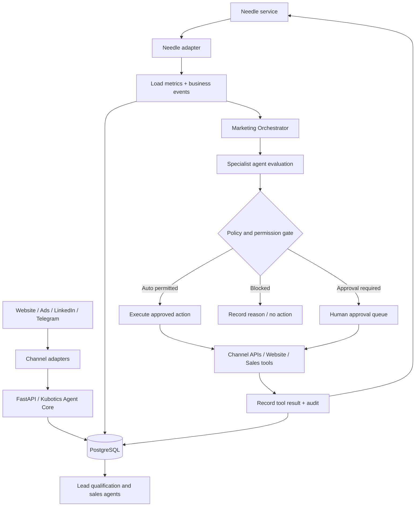

# Kubotics — Agentic Go-to-Market Plan
**Website review, sales & marketing strategy, Needle-triggered operating model and 7-day CHF 100 experiment**

- **Prepared:** 1 November 2026
- **Test window:** 2–8 November 2026 (or the first seven active days after implementation)
- **Initial paid-media ceiling:** CHF 100 total
- **System of record:** Existing PostgreSQL platform — do not introduce HubSpot
- **Operating principle:** One shared Kubotics Agent Core, with channel adapters and specialist agents
- **Orchestration requirement:** Needle service triggers evaluations and agent work; agents make evidence-based decisions and execute only within explicit permissions

---

## 0. Implementation status — shipped 1 November 2026 (commit `40d5446`, pushed to `main`)

Delivered by the website/backend agent and code-verified by Jcode:

- **Updated booking URL** — set to `https://bookings.cloud.microsoft/book/KuboticsGet2Know@kuroliv.ch/?ismsaljsauthenabled` in:
  - frontend lead-agent service and booking-link triggers
  - backend `api/v1` meeting fallback endpoints and agent core
  (replaces the previous `outlook.office.com/bookwithme/...` link)
- **Dedicated topic landing pages**, each with an interactive problem-intake card and direct question actions:
  - `/automation/cnc-machine-tending`
  - `/automation/invoice-processing`
  - `/robotics/unitree-h2-test-day`
  - `/automation/discovery`
- **In-chat booking flow** — structured contact-capture card (Name, Email, Phone, Company, Preferred Date/Slot) ensuring complete lead ingestion into PostgreSQL and native Microsoft Teams meeting generation.
- **Git:** pushed to `github.com:vincent-verbeke/Websites.git` (`main`), commit `40d5446`.

Follow-up same day (commit `a990349`): cloud `/dashboard`, scheduler API
(`tasks`, `events`, `agent/output`, `ingest`) and Entra ID login — frontend
deployed and verified on the CDN; **backend half currently failing to deploy**
(see `PROMPT_website_agent_dashboard_cloud_2026-11-01.md` §8 and
`GTM_TEST_READINESS_2026-11-01.md` B1).

Impact on this plan:
- §8 Day 1 item *"Build / publish the dedicated CNC machine-tending landing page"* → **satisfied** (page shipped; keep the quality gate of §2/§5.4 in the verification pass).
- §8 Day 1 item *"Test website CTA … form"* → now covers four topic pages plus the in-chat booking card; the E2E conversion-route check (P0) must include all four URLs and the Teams-meeting creation path.
- The in-chat booking card is the first **complete** lead-capture path into PostgreSQL — verify UTM/first-touch attribution on it before paid spend (§10.3); **currently blocked: UTM fields are accepted but not persisted (readiness B2).**

---

## 1. Executive recommendation

Kubotics has a credible technical proposition and a substantially improved website. The next step is not to add more marketing automation. It is to turn the website and its acquisition channels into a measurable sales system.

The first experiment should test whether Kubotics can consistently turn a clearly defined Swiss manufacturing problem into a qualified business conversation.

**Recommended initial campaign:**
- **ICP:** Swiss manufacturing SMEs and industrial operators with repetitive production bottlenecks, initially CNC machine tending / machine loading and unloading.
- **Buyer roles:** Managing Director, Head of Operations, Production Manager, Industrial Engineering / Automation Manager.
- **Offer:** A focused Automation Discovery Session. Kubotics reviews one repetitive process, estimates feasibility and identifies the next practical validation step. Do not promise a guaranteed ROI or a turnkey robot before understanding the process.
- **Primary CTA:** “What would you like to automate?” → short AI-led discovery → qualified assessment → meeting / site visit / test.
- **Primary paid channel for this test:** tightly controlled Google Search (not Performance Max).
- **Supporting channels:** founder-led LinkedIn content, targeted account research and compliant one-to-one business development.
- **Budget:** Maximum CHF 100. Start with CHF 70 Google Search; keep CHF 30 as a controlled reserve. Do not spend the reserve automatically just because it exists.

The goal of this first week is **not statistical proof of scalable paid acquisition**. CHF 100 and seven days are insufficient to prove that. The goal is to validate tracking, message-market fit, lead quality, agent response, and the Needle decision loop.

### Success criteria for the first week

A useful outcome is:
- All website and channel interactions are attributable to a source/campaign.
- At least 10 relevant target accounts are researched and approached through appropriate channels.
- At least 3 substantive conversations or qualified enquiries are generated (organic and paid combined).
- At least 1 qualified discovery meeting is booked, or there is enough evidence to identify the precise bottleneck.
- Needle generates at least one useful, auditable evaluation and recommendation.
- No spend is increased without a measured reason and permission.

These are experiment targets, not promised results.

---

## 2. Critical review of the live website

Reviewed: [https://www.kubotics.ch](https://www.kubotics.ch)

The current homepage now contains a much stronger lead-in: **“Was möchten Sie automatisieren?”**, a free-text prompt, use-case quick starts, ROI calculator, readiness assessment, robotics portfolio and direct contact options. This is the right direction: let the prospect describe the problem before forcing them to select a technology.

### 2.1 What is working

| Area | Current strength | Recommendation |
|---|---|---|
| Positioning | Swiss robotics, factory automation and AI-enabled processes | Keep, but make the commercial outcome more prominent |
| Main interaction | “What would you like to automate?” | Make this the primary conversion path and instrument every step |
| Quick-start use cases | CNC, H2, invoice/document LLM, robot arms, palletising/logistics | Retain as intent shortcuts; map each to a separate sales journey |
| ROI calculator | Gives a tangible business reason to engage | Show transparent assumptions and capture a report request |
| Readiness assessment | Useful qualification mechanism | Save answers, score, recommendations and contact permission in PostgreSQL |
| Unitree H2 | Differentiated product and test-day proposition | Give it a dedicated campaign/landing page and booking path |
| Messaging | WhatsApp and Telegram offer direct access | Preserve, but ensure all channels create the same lead/conversation records |
| Contact form | Conventional fallback exists | Test delivery, validation, consent wording and CRM/database persistence |

### 2.2 P0 — fix before increasing paid traffic

1. **Make one offer dominant.** The homepage still presents several distinct markets at once: humanoid robots, industrial robot arms, ERP/process automation, invoice processing and voice/chatbots. This breadth is useful as a portfolio but weak as a single campaign proposition. Keep the portfolio, but each campaign must have one ICP, one pain point, one offer and one CTA.

2. **Make the promise concrete.** For the initial campaign, use a message such as:
   > Identify one repetitive production task that may be suitable for automation. Kubotics assesses the process, integration requirements and practical next step — before you commit to hardware.

3. **Create dedicated landing pages.** At minimum:
   - `/automation/cnc-machine-tending` — manufacturing and machine tending.
   - `/automation/invoice-processing` — finance teams and document-heavy SMEs.
   - `/robotics/unitree-h2-test-day` — research, innovation and industrial pilot prospects.
   - `/automation/discovery` — general discovery and qualification.

   Use the actual site routing convention; these are proposed paths, not claims that these URLs already exist.

4. **Make conversion events reliable.** Verify that the website records:
   - CTA click and selected use case.
   - Assessment started / completed and score.
   - ROI calculator inputs and report request.
   - Chat started / qualified / handed off.
   - Contact form submitted / validated.
   - Meeting requested / booked / attended.
   - Lead qualified / disqualified and reason.

   A button click is not a qualified lead. A form submission is not a sales opportunity.

5. **Test every contact route end-to-end.** Verify that website form, WhatsApp, Telegram and any web-chat flow create or update the same PostgreSQL lead/contact record, preserve source attribution and notify the responsible agent/person. Test duplicate detection and failed delivery.

6. **Add a privacy and marketing-permission model.** Explain what data is collected, why, retention, processors and contact preferences. Separate responding to an enquiry from permission to send ongoing marketing. Do not silently enrol assessment or chatbot users in promotional sequences.

7. **Make booking frictionless.** A qualified prospect should be able to request a 30-minute discovery call or a relevant H2 / process test. Store requested date, timezone, preferred channel and meeting outcome.

### 2.3 P1 — credibility and conversion quality

**Substantiate technical and performance claims.** The current page displays or references claims such as:
- Precision 0.01 mm.
- Speech response around 100 ms.
- System autonomy level 5.
- Error reduction above 98.5%.
- Availability 24/7.
- ROI example of CHF 161,520 annual benefit, 1,800 hours saved and 2.5-month payback.
- Official Unitree partner / specialist positioning in Switzerland and Europe.

These may be defensible in a specific system or test context, but the page should explain the measurement, assumptions, scope and source. Do not present illustrative calculator output as a verified customer result. For robot specifications, distinguish manufacturer specifications from Kubotics' own measured system performance. Clarify what “autonomy level 5” means in this context or remove it.

**Add proof that lowers perceived risk:**
- Short, real video demonstrations (not generic stock visuals).
- One or two practical use-case walkthroughs.
- Integration architecture and supported interfaces.
- Safety, commissioning, training and after-sales support approach.
- A clear “what happens during a test day?” description.
- Named customer examples only with permission; otherwise use clearly labelled internal demonstrations or anonymised case studies.

**Improve the ROI calculator:**
- Make all assumptions visible and editable.
- Separate labour capacity released from cash savings.
- Include implementation, integration, maintenance and operating costs.
- Include confidence ranges and “estimate only” wording.
- Offer a downloadable report only after the visitor provides appropriate contact details and understands the purpose.
- Store the exact inputs, formula version and output so an agent can explain the estimate later.

**Improve the readiness assessment:**
- Verify that the visible score is actually calculated from the selected answers (the public page extraction showed a 45% example; confirm that this is not a fixed default).
- Explain the score and next step.
- Ask for business contact details only when needed for a requested follow-up.
- Do not infer that a high score means a robot is automatically feasible.

### 2.4 P2 — SEO, language and usability

- Ensure German and English pages are genuinely complete, not just a language toggle.
- Use one page per search intent, with descriptive titles, meta descriptions, H1s and internal links.
- Add structured data where appropriate (Organization, Product/Service, FAQ only where visible and accurate).
- Ensure pages load quickly on mobile and that forms/chat remain usable.
- Check accessibility: keyboard navigation, form labels, contrast, focus states and meaningful button names.
- Add analytics consent controls where required and avoid loading non-essential tracking before the applicable consent.
- Provide a visible company identity, contact details, legal notice and privacy policy; verify that these pages are complete and accessible.

### 2.5 Suggested homepage hierarchy

1. Outcome-led headline: “Automate repetitive work in production and business operations.”
2. Subheadline: “Swiss engineering, robotics and AI integration — from feasibility assessment to implementation.”
3. Primary prompt: “What would you like to automate?”
4. Three buyer-oriented entry points:
   - Production & machine tending.
   - Documents & business processes.
   - Humanoid robotics & Unitree H2.
5. Proof: real demo, integration capability, support and case evidence.
6. Simple process: Discover → Assess → Validate → Implement → Support.
7. ROI / readiness tools.
8. Clear contact and booking options.

---

## 3. Go-to-market strategy

### 3.1 Positioning

Recommended core positioning:

> **Kubotics helps Swiss companies identify, validate and implement automation opportunities — combining robotics, AI and business-system integration.**

Do not lead with “we sell robots”. Lead with the operational problem and measurable business outcome. Technology is the solution, not the starting point.

### 3.2 Initial ICP and segmentation

Start narrow for the first experiment.

| Segment | Buyer / trigger | Problem | Kubotics entry offer |
|---|---|---|---|
| Swiss manufacturing SMEs | Owner, Operations / Production Manager | Repetitive machine tending, labour constraints, inconsistent throughput | CNC / machine-tending discovery |
| Document-heavy SMEs | CFO, Finance Manager, Administration Lead | Manual invoice and document processing | Invoice workflow assessment |
| Robotics / research / innovation | Lab lead, CTO, Innovation Manager | Need access to humanoid robotics and integration expertise | Unitree H2 test day / technical workshop |

**Week-one focus:** manufacturing SMEs with a plausible repetitive production process. Do not run three separate paid campaigns with CHF 100. Other segments can still be served when inbound intent identifies them.

### 3.3 Offer ladder

1. **Entry:** short automation discovery conversation.
2. **Qualification:** structured process and feasibility assessment.
3. **Validation:** paid or explicitly scoped proof-of-concept / test day, depending on use case.
4. **Implementation:** engineering, integration, commissioning and training.
5. **Expansion:** additional cells, workflows, robots or business-system integrations.

Do not automatically promise a free site visit or free engineering work. The initial discovery call can be short; deeper feasibility work should have a defined scope and commercial model.

### 3.4 Messaging

Use the following message pattern:

- **Pain:** “Your team loses capacity on repetitive machine-loading tasks.”
- **Outcome:** “Find out whether this task can be automated safely and economically.”
- **Method:** “Kubotics reviews the process, cycle, interfaces, constraints and expected return.”
- **CTA:** “Describe the task and request an automation discovery session.”

Avoid unsupported claims such as guaranteed savings, universal 24/7 uptime, fully autonomous operation or fixed payback periods.

---

## 4. Channel strategy and CHF 100 budget

### 4.1 Week-one allocation

| Activity | Maximum spend | Purpose |
|---|---:|---|
| Google Search campaign | CHF 70 | Capture explicit, high-intent searches |
| Controlled reserve | CHF 30 | Release only if Needle's evaluation supports a change or extension |
| Founder-led LinkedIn organic | CHF 0 media spend | Credibility, education and conversation |
| Target-account research / personal follow-up | CHF 0 media spend | Learn from the market and create conversations |
| **Total ceiling** | **CHF 100** | Never exceed without explicit approval |

The CHF 30 reserve is not an instruction to spend. If there is no credible paid channel to move it to, leave it unspent.

### 4.2 Why not Performance Max this week?

Do not judge Performance Max from a tiny CHF 100, seven-day test. Google's own lead-generation guidance stresses accurate conversion tracking, high-quality lead signals and sufficient learning time; it recommends allowing at least 1–2 weeks (and potentially longer) for learning. For value-based optimization it points to a conversion goal with at least 15 conversions in the previous 30 days. A brand-new B2B campaign with very few conversions cannot provide that signal.

For this test:
- Pause or keep PMax at zero incremental spend if it is currently spending without useful, attributable qualified leads.
- Do not feed it page views or low-intent clicks as if they were sales outcomes.
- Audit conversion actions, location targeting, search-term insights, assets and lead quality before restarting.
- Keep PMax as a future candidate, not the default channel.

Official reference: [Google Ads — Performance Max best practices for lead generation](https://support.google.com/google-ads/answer/13775965/).

### 4.3 Google Search setup

Create one Search campaign, not PMax.

**Campaign:** `CH | Manufacturing | Automation Discovery | Search | 2026-11`

**Geo:** Switzerland, initially focus on regions Kubotics can serve commercially and operationally. Use presence-based location targeting (people in or regularly in the target locations), not broad “interest in” targeting.

**Language:** German first for the initial Swiss manufacturing test; add English only if the landing page and sales follow-up are ready. Do not mix language variants without tracking them separately.

**Keyword themes (start with exact / phrase match and review search terms):**
- “CNC machine tending automation”
- “Maschinenbeschickung automatisieren”
- “CNC Automation Schweiz”
- “Roboter Maschinenbeschickung”
- “Maschinenbeladung Roboter”
- “Fabrikautomation Roboter”

Use negative terms for employment, jobs, salary, training-only searches, DIY/hobby projects, consumer robots and unrelated robot toys. Review actual search terms daily; do not assume the proposed list has sufficient search volume.

**Ad copy direction:**
- Headline: “CNC-Maschinenbeschickung automatisieren”
- Headline: “Automationspotenzial prüfen”
- Description: “Kubotics prüft Ihren Prozess, die technische Machbarkeit und den nächsten sinnvollen Schritt. Schweizer Engineering für Industrieautomation.”
- CTA: “Automationsgespräch anfragen”

**Landing page:** one dedicated page for CNC/machine tending, with the same language and promise as the ad. Do not send all paid traffic to the generic homepage.

**Budget controls:**
- Hard campaign budget cap: CHF 70 for the week.
- Target daily pacing around CHF 10, but use the platform's actual budget controls and check its billing behaviour.
- Do not raise bids or budget just to obtain impressions.
- If the campaign cannot obtain relevant impressions, diagnose search volume, match types, geography and bid competitiveness before spending elsewhere.

### 4.4 Supporting channels

**LinkedIn organic — founder-led**
Publish two useful posts this week:
1. A short practical post: “Which repetitive production task would you automate first?” Include a real example or a clear process checklist.
2. A short video / photo walkthrough of an actual robotic or automation capability, with limitations and use case explained honestly.

The objective is replies and relevant conversations, not vanity engagement. Reply personally and log meaningful interactions in PostgreSQL.

**Target-account approach**
- Research 10–20 Swiss manufacturing companies with a visible fit.
- Record the reason each company is relevant (sector, production process, facility, public evidence).
- Identify the appropriate business role, not just any available personal email.
- Prefer a relevant, lawful phone approach or a genuinely individual business enquiry. Do not run an automated cold-email sequence.
- Record source, date, purpose, contact restrictions and outcome.
- Ask permission before sending follow-up material or adding a person to ongoing marketing.

**Referrals and existing relationships**
Ask existing business contacts, suppliers and professional network members for introductions to one or two manufacturing companies with a relevant automation challenge. Track referrals separately.

### 4.5 Channel expansion logic

Potential channels to test later, based on observed demand:
- Google Search for explicit demand.
- LinkedIn organic and carefully targeted paid campaigns for role / account awareness.
- Industry associations, manufacturing events and partner referrals.
- Demonstration days and technical workshops for Unitree / robotics.
- SEO and technical content for long-term intent capture.
- Direct mail or compliant telephone outreach for selected Swiss accounts.

Do not activate all channels at once. Needle should identify the next experiment from evidence, available budget, lead quality and execution capacity.

---

## 5. Agentic marketing and sales architecture

### 5.1 Architectural constraints

Carry forward the agreed platform direction:

- Existing PostgreSQL is the system of record; do not add HubSpot.
- One shared Kubotics Agent Core.
- Channel adapters for website, Telegram first, then Teams/M365 and later telephony.
- Persist conversations, agent runs, tool calls/results, business events and audit records.
- Keep business data and channel-specific transport separate.
- Use explicit tools, permissions, guardrails and human handoff.

### 5.2 Needle is the trigger and evaluation layer

**Required design:** the Needle service must trigger the marketing and sales evaluation cycle. Do not implement a separate uncoordinated collection of cron jobs that independently makes marketing decisions.

The exact Needle API, event schema and scheduling contract must be taken from the actual deployed service. This document does not assume or invent endpoint names, payload fields or capabilities that have not been verified.

Implement a small, explicit adapter between Needle and the Kubotics Agent Core:

1. Needle emits a scheduled or event-driven evaluation trigger.
2. The adapter validates the trigger, deduplicates it and records it.
3. The adapter loads the relevant metrics and business context from PostgreSQL and approved channel integrations.
4. It creates an `agent_run` for the appropriate specialist agent.
5. The agent analyses evidence and returns a structured recommendation / action proposal.
6. Policy checks determine whether the action is automatic, requires approval or is prohibited.
7. Approved actions execute through channel tools / APIs.
8. Results, tool calls, costs and before/after metrics are persisted.
9. Needle triggers a later evaluation to determine whether the action worked.

**Important:** Needle should trigger work; it should not be a hidden source of unlogged decisions. Every decision must be explainable and traceable.

### 5.3 Suggested specialist agents

| Agent | Responsibility | Trigger examples |
|---|---|---|
| Marketing Orchestrator | Selects next experiment and allocates permitted budget | Daily evaluation, campaign underperformance, new market signal |
| Website Conversion Agent | Analyses funnel, content and conversion drop-offs | Traffic / conversion event, daily funnel review |
| SEO & Content Agent | Finds search-intent gaps and proposes content | Weekly content evaluation, search-query trends |
| Paid Acquisition Agent | Evaluates Search / PMax / other paid channels | Daily campaign metrics, budget threshold |
| Lead Qualification Agent | Scores fit, need, urgency, authority and next step | New form, assessment, chat or message |
| Sales Agent | Conducts discovery, follows up where permitted and books meetings | Qualified lead, requested callback, meeting request |
| Research Agent | Builds target-account intelligence and use-case hypotheses | Weekly prospecting task |
| Reporting Agent | Produces daily / weekly performance summary | Needle scheduled reporting trigger |
| Compliance / Policy Gate | Checks permissions, contact rules, claims and spend limits | Before any external action |

Agents may collaborate, but the shared Agent Core owns context, permissions, tool execution and audit.

### 5.4 Event-driven workflow



### 5.5 Minimum event model

Use existing schemas / naming conventions if already present. The following are logical entities, not a demand to duplicate existing tables.

- `contacts` — person / business identity and contact preferences.
- `accounts` — target and customer companies.
- `leads` — commercial need, status, qualification and owner.
- `conversations` — channel-neutral conversation record.
- `messages` — inbound and outbound messages.
- `campaigns` — objective, channel, offer, budget, dates and status.
- `campaign_metrics` — dated impressions, clicks, spend, conversions and quality outcomes.
- `website_events` — CTA, calculator, assessment and funnel events.
- `agent_runs` — agent, trigger, inputs reference, status, output and duration.
- `tool_calls` — tool, arguments reference, result, error and cost.
- `business_events` — normalized events such as `lead.created`, `lead.qualified`, `meeting.booked`, `campaign.threshold_breached`.
- `decision_records` — evidence, options considered, selected action, confidence, policy result and approver.
- `approvals` — action, requester, approver, status, timestamp and reason.
- `audit_log` — immutable record of material actions and changes.
- `contact_permissions` / suppression records — channel-specific consent, objection and do-not-contact status.

Every campaign metric must be attributable to a campaign, channel, date/time and source. Store raw source data or stable references where practical, plus normalized fields for evaluation.

### 5.6 Minimum event contract

Needle adapter should normalize triggers into a stable internal envelope, for example:

```json
{
  "event_id": "unique-id",
  "event_type": "marketing.evaluation.requested",
  "trigger_source": "needle",
  "triggered_at": "ISO-8601 timestamp",
  "scope": {
    "campaign_id": "campaign-id",
    "channel": "google_search",
    "period_start": "2026-11-02",
    "period_end": "2026-11-08"
  },
  "reason": "scheduled_review",
  "correlation_id": "trace-id"
}
```

This is a proposed internal normalized contract. Map the actual Needle payload into it; do not require Needle itself to emit this exact JSON.

Required behaviour:
- Idempotency by `event_id` / deduplication key.
- Correlation IDs across Needle → agent run → tool call → result.
- Retry with bounded backoff for transient errors.
- Dead-letter / failed-trigger visibility.
- Timezone-aware schedules (Europe/Zurich for Swiss campaign operations).
- Explicit evaluation window and freshness timestamp for metrics.
- No action when source data is stale, incomplete or contradictory.
- Every run has a status and terminal outcome.

### 5.7 Agent output contract

Every decision agent should return structured data similar to:

```json
{
  "summary": "Search campaign has relevant impressions but no qualified enquiries yet.",
  "evidence": [
    {
      "metric": "qualified_leads",
      "value": 0,
      "period": "2026-11-02/2026-11-04",
      "source": "postgresql.campaign_metrics"
    }
  ],
  "diagnosis": "Insufficient evidence to conclude channel-market fit; inspect search terms and landing-page conversion.",
  "recommendation": "Continue within the existing CHF 70 cap while fixing tracking and reviewing query relevance.",
  "proposed_actions": [],
  "confidence": 0.72,
  "requires_human_approval": false,
  "policy_checks": [],
  "next_evaluation_at": "ISO-8601 timestamp"
}
```

The example is illustrative. Agents must cite actual metric records / source references, not invent numbers.

---

## 6. Autonomous decision policy: channel selection and budget control

### 6.1 Core rule

**Agents should optimize for qualified pipeline, not cheap clicks.**

Primary KPI hierarchy:
1. Qualified opportunities.
2. Discovery meetings booked and attended.
3. Sales-accepted leads.
4. Valid enquiries / conversations.
5. Landing-page conversion rate.
6. Cost per qualified lead (when sample size allows).
7. Search relevance, CTR and CPC as diagnostic metrics.
8. Impressions and raw traffic as context only.

Do not allow an agent to declare success based on impressions, clicks, chatbot starts or low-quality form submissions alone.

### 6.2 Google PMax decision logic

The Paid Acquisition Agent must evaluate PMax against:
- Correct conversion tracking.
- Conversion action quality and depth.
- Spend and campaign age.
- Search-term / category insights and placement quality where available.
- Geographic relevance.
- Landing-page alignment.
- Valid enquiries, qualified leads and eventual sales outcomes.
- Whether enough conversion volume exists for platform optimization.

**Possible decisions:**
- `CONTINUE`: campaign is within budget, tracking is valid, search intent is relevant and learning period is not complete.
- `FIX_TRACKING`: spend / traffic exists but conversion data is missing or incorrect.
- `RESTRICT`: irrelevant geography, queries, placements or landing-page destinations are identified.
- `PAUSE`: hard budget limit reached, tracking is broken, clear policy violation, or sustained waste is evidenced under a pre-approved rule.
- `RETEST_LATER`: insufficient conversion volume; do not repeatedly change settings during learning.
- `SHIFT_BUDGET`: only when another channel has stronger evidence and the reallocation is within approved budget / permission limits.

Do not pause PMax merely because it produced zero leads in the first day or two. Conversely, do not keep spending indefinitely because the platform says it is learning.

### 6.3 Initial experiment thresholds

These are **operational guardrails for this small test**, not statistically validated benchmarks.

| Signal | Agent interpretation | Allowed response |
|---|---|---|
| Tracking test fails | Results cannot be trusted | Stop paid spend until fixed |
| Search terms are clearly irrelevant | Targeting mismatch | Add negatives / tighten match types |
| CHF 20 spent with no relevant search terms | Early waste signal | Pause and diagnose; approval required to resume |
| CHF 35 spent, relevant clicks but no meaningful engagement | Landing page / message mismatch possible | Review query-to-page match; do not automatically increase bids |
| CHF 50 spent, no valid enquiry | Strong reason to inspect funnel | Pause further spend pending human review |
| Any qualified enquiry | Positive signal, not proof | Follow up quickly; preserve campaign and source data |
| CHF 70 campaign cap reached | Budget cap | Stop campaign; no automatic overrun |
| Alternative channel generates qualified meeting | Stronger early signal | Recommend next controlled test; do not automatically move money outside approved cap |

Needle should evaluate at least daily during the experiment, and immediately on critical events such as budget cap, tracking failure or qualified lead. Avoid rapid bid / budget changes based on tiny samples.

### 6.4 Permission levels

| Action | Default permission |
|---|---|
| Read campaign metrics and website events | Automatic |
| Analyse funnel / search terms | Automatic |
| Draft ad copy / LinkedIn posts | Automatic |
| Suggest keyword negatives | Automatic recommendation |
| Apply low-risk negative keywords | Automatic only if explicitly enabled and logged |
| Pause a campaign on hard budget / tracking safety rule | Automatic if pre-authorized |
| Create a new paid campaign | Human approval |
| Increase total weekly / monthly budget | Human approval |
| Reallocate spend between channels | Human approval unless a precise capped rule is pre-authorized |
| Publish public content | Human approval initially |
| Send direct prospect messages | Human approval initially; channel-specific legal / permission checks |
| Send marketing email sequences | Block unless valid consent / lawful basis and policy are verified |
| Make claims about customer results or guaranteed ROI | Human approval and evidence required |
| Quote price, sign contract or commit delivery dates | Human approval |

The agents should be autonomous in analysis, prioritization and low-risk operations, not unrestricted in financial commitments or external communications.

---

## 7. Sales workflow

### 7.1 Lead journey

```text
VISITOR
  → INTENT CAPTURED
  → USE CASE IDENTIFIED
  → QUALIFICATION IN PROGRESS
  → SALES-ACCEPTED LEAD
  → DISCOVERY MEETING REQUESTED
  → MEETING BOOKED
  → DISCOVERY COMPLETED
  → FEASIBILITY / TEST PROPOSED
  → PROPOSAL
  → WON / LOST / NURTURE
```

Each transition must create a timestamped business event.

### 7.2 Qualification dimensions

Score the lead using evidence, not assumptions:

- **Fit:** industry, geography, company size and process relevance.
- **Problem:** specific repetitive task / bottleneck and impact.
- **Feasibility:** process repeatability, interfaces, safety constraints and environment.
- **Value:** time, cost, throughput, quality or capacity impact.
- **Authority:** role of contact and access to decision-makers.
- **Timing:** urgency and project horizon.
- **Next step:** willingness to share process information or book discovery.

Do not disqualify an interesting opportunity solely because the visitor does not know the technical solution.

### 7.3 First conversation

The website / Telegram agent should:
1. Acknowledge the stated problem.
2. Ask what task or process is involved.
3. Ask how often it occurs and what makes it difficult.
4. Ask what the current process / equipment is.
5. Ask about the desired outcome and timeframe.
6. Ask whether the person is involved in evaluating the project.
7. Summarize the use case and ask permission to arrange a discovery call.
8. Hand off to a human when safety, engineering, pricing or contractual commitments are involved.

Keep the conversation natural. Do not ask eight questions in one form. Ask one useful question at a time and stop when enough is known to offer a next step.

### 7.4 Response and follow-up SLA

- New inbound lead: acknowledge immediately where the agent channel is available.
- Qualified inbound lead: notify sales owner immediately.
- Human response target during business hours: within one business day.
- Meeting request: confirm the requested details and book only after calendar availability is checked.
- After discovery: log outcome, next action, owner and due date.
- No response: do not start an automated marketing sequence unless the channel and permission status allow it.

### 7.5 Sales metrics

- New leads by source.
- Qualified lead rate.
- Time to first response.
- Meetings requested / booked / attended.
- Feasibility assessments proposed.
- Proposals issued.
- Pipeline value and stage conversion.
- Lost reasons.
- Lead source to opportunity and revenue attribution.

---

## 8. Seven-day execution plan: 2–8 November 2026

### Day 1 — Monday: instrument and prepare

- Confirm the primary campaign ICP and offer.
- Test website CTA, assessment, ROI calculator, form, WhatsApp and Telegram.
- Verify PostgreSQL persistence, source attribution and duplicate handling.
- Verify consent / privacy wording and suppression logic.
- Set up campaign and conversion events.
- Build / publish the dedicated CNC machine-tending landing page or use a clearly isolated section if the page cannot be completed.
- Confirm Needle can trigger a test evaluation and that the resulting agent run is auditable.

**Gate:** Do not activate paid spend until test conversions and attribution are working.

### Day 2 — Tuesday: launch

- Launch Google Search with maximum CHF 70 campaign budget.
- Publish LinkedIn post 1.
- Research first 10 target accounts.
- Run the first Needle daily evaluation.
- Check search terms, geo, ad approval and landing-page relevance.

### Day 3 — Wednesday: qualify and diagnose

- Review every enquiry and conversation.
- Sales agent classifies leads; human reviews borderline / high-value cases.
- Research another 5–10 accounts.
- Make individual, relevant follow-up only through permitted channels.
- Needle evaluates spend, search relevance, engagement and lead quality.
- Do not change multiple campaign variables at once.

### Day 4 — Thursday: improve one bottleneck

- Identify the biggest funnel bottleneck: impressions, relevant clicks, landing-page engagement, enquiry or qualification.
- Change one major variable only (for example keyword relevance or landing-page headline).
- Publish LinkedIn post 2 with a real demonstration / process example.
- If the campaign has spent CHF 20 without relevant search terms, pause and diagnose before further spend.

### Day 5 — Friday: evaluate channel and offer

- Review all campaign and sales data.
- If tracking is reliable and search intent is relevant, continue within the existing cap.
- If paid search is weak, do not blindly transfer spend to PMax or LinkedIn ads. Ask the Marketing Orchestrator to compare available alternatives and recommend the next experiment.
- Use the CHF 30 reserve only after a documented decision and approval.
- Contact warm referrals / existing network for introductions.

### Day 6 — Saturday: technical review

- Review agent runs, failed triggers, tool errors and data quality.
- Check whether Needle's evaluations used fresh data and made actionable recommendations.
- Review all automatic actions and approval records.
- Prepare a short list of website fixes for the next sprint.

### Day 7 — Sunday: decision and next experiment

Produce a report with:
- Spend by channel.
- Impressions, clicks and search terms.
- Website funnel events.
- Enquiries, qualified leads and meetings.
- Cost per valid enquiry / qualified lead where meaningful.
- Lead quality and objections.
- Needle triggers, recommendations and executed actions.
- What worked, what failed and confidence level.
- Recommended next-week budget and channel test, with reason.

Do not scale on the basis of a single lead. Preserve the evidence and run the next controlled experiment.

---

## 9. Daily Needle evaluation checklist

Every scheduled evaluation should answer:

1. Did all required data sources report successfully?
2. Is the data fresh and complete for the evaluation window?
3. How much budget was spent by campaign and channel?
4. Which searches / audiences generated relevant engagement?
5. Did any visitor express a real business need?
6. Which leads meet the sales qualification criteria?
7. Where does the conversion funnel lose prospects?
8. Is the current channel still the best use of the remaining budget?
9. Is there evidence to continue, fix, restrict, pause or test another channel?
10. Does the proposed action require approval?
11. What measurable result should the next Needle evaluation check?

### Example decision output

```json
{
  "evaluation": "daily_paid_channel_review",
  "decision": "FIX_AND_CONTINUE_WITHIN_CAP",
  "reason": "Relevant search intent is present, but the enquiry event is not being recorded reliably.",
  "evidence_refs": [
    "campaign_metrics:<record-id>",
    "website_events:<record-id>"
  ],
  "actions": [
    {
      "type": "create_tracking_fix_task",
      "requires_approval": false
    },
    {
      "type": "do_not_increase_budget",
      "requires_approval": false
    }
  ],
  "budget": {
    "weekly_cap_chf": 70,
    "additional_spend_authorized_chf": 0
  },
  "next_evaluation": "next scheduled Needle trigger"
}
```

This is an illustrative output contract, not an existing API schema.

---

## 10. Measurement and reporting

### 10.1 North-star metric

**Sales-accepted qualified opportunities created per CHF spent and per hour of human sales effort.**

For the first week, report the raw counts and evidence. Do not calculate misleading conversion rates from tiny denominators.

### 10.2 Required dashboard

| Category | Metrics |
|---|---|
| Spend | Budget, actual spend, remaining cap, spend by channel |
| Reach | Impressions, clicks, search terms, target accounts reached |
| Website | Landing sessions, CTA clicks, assessment starts/completions, form submissions |
| Conversations | Chat starts, meaningful conversations, handoffs |
| Sales | Qualified leads, meetings booked/attended, feasibility requests |
| Economics | Cost per valid enquiry, cost per qualified lead, pipeline created |
| Agentic operations | Needle triggers, successful runs, failures, decisions, approvals, actions |
| Quality | Spam rate, irrelevant leads, lost reasons, response time |

### 10.3 Attribution requirements

Capture:
- UTM source, medium, campaign, content and term.
- Referrer and landing page.
- First-touch and last-touch attribution.
- Click IDs where available and permitted.
- Campaign / ad group / keyword references where available.
- Lead and account IDs.
- Consent / contact permission state.
- Conversion stage and timestamp.

Never overwrite first-touch attribution when a lead returns through another channel.

---

## 11. Compliance, trust and safety

This is a Swiss B2B operation. Treat marketing permissions as first-class business data.

- The Swiss FDPIC states that advertising by email generally requires explicit, informed opt-in, with a limited existing-customer exception for similar products/services and an opt-out mechanism. See [FDPIC — Advertising & marketing](https://www.edoeb.admin.ch/en/advertising-marketing).
- Do not use automated or serial unsolicited cold-email campaigns as a workaround. A genuinely individual business enquiry is a different fact pattern, but the legal boundary can be uncertain. Obtain appropriate advice for the exact workflow.
- Store contact source, purpose, permission, objections and suppression status.
- Respect objections immediately across all channels.
- Do not assume a public email address or business card is marketing consent.
- For phone outreach, check applicable Swiss directory protections and contact restrictions before calling.
- Do not scrape or enrich personal data without a defined purpose, proportionality and appropriate transparency.
- Provide a human contact route and human review for consequential decisions.
- Do not let an agent invent customer references, technical certifications, ROI, robot capabilities or delivery promises.
- Keep a complete audit trail for automated decisions and external actions.
- Apply least-privilege credentials and separate read-only analytics access from spend-changing credentials.

Useful references:
- [FDPIC — Advertising & marketing](https://www.edoeb.admin.ch/en/advertising-marketing)
- [Swiss Federal Data Protection Act (FADP)](https://www.fedlex.admin.ch/eli/cc/2022/491/en)
- [Google Ads — Performance Max lead-generation guidance](https://support.google.com/google-ads/answer/13775965/)

This section is an operational checklist, not legal advice.

---

## 12. Implementation backlog for the coding agents

### P0 — required for the first experiment

- [ ] Verify all website conversion routes end-to-end.
- [ ] Normalize website, Telegram and WhatsApp inbound events.
- [ ] Persist lead source / campaign / UTM attribution.
- [ ] Confirm PostgreSQL is the only commercial system of record.
- [ ] Implement or verify Needle → adapter → Agent Core trigger path.
- [ ] Ensure idempotency, correlation IDs, retries and failed-trigger visibility.
- [ ] Implement daily campaign metrics ingestion.
- [ ] Implement lead qualification and human handoff.
- [ ] Implement CHF 100 total spend cap and CHF 70 Search campaign cap.
- [ ] Implement approval gate for campaign creation, budget increases and external publishing.
- [ ] Add audit records for every decision and tool action.
- [ ] Verify privacy notice and contact permission handling.

### P1 — next iteration

- [ ] Dedicated CNC machine-tending landing page.
- [ ] Separate Unitree H2 and invoice automation landing pages.
- [ ] ROI calculator assumption transparency and report capture.
- [ ] Readiness assessment persistence and dynamic scoring verification.
- [ ] Search-term and paid-channel evaluation agent.
- [ ] Weekly content / SEO agent.
- [ ] Account research workflow.
- [ ] Sales pipeline dashboard and loss reasons.
- [ ] Calendar integration for meeting booking (with availability checks).

### P2 — scale after evidence

- [ ] LinkedIn paid experiments.
- [ ] Additional Google Search campaigns by use case.
- [ ] PMax retest only after conversion data quality and volume improve.
- [ ] Partner / association referral programmes.
- [ ] Industry events and demonstration days.
- [ ] Additional language and geographic campaigns.
- [ ] More autonomous low-risk channel optimization with bounded permissions.

---

## 13. Final operating principles

1. **PostgreSQL remains the source of truth.** No HubSpot dependency.
2. **Needle triggers the loop.** Do not build uncoordinated marketing automation outside the Needle evaluation and event model.
3. **Agents decide from evidence.** Every recommendation must cite its metrics and evaluation period.
4. **Optimize for qualified pipeline.** Clicks and impressions are diagnostics, not success.
5. **One experiment at a time.** One ICP, one offer, one landing page, one paid campaign for the first week.
6. **Hard budget boundaries.** CHF 100 total; CHF 70 initial Search cap; CHF 30 reserve is not pre-authorized spend.
7. **Human approval for material external actions.** Especially new campaigns, spend increases, public publishing, prospect sequences, pricing and commitments.
8. **No PMax dependency.** The system must be able to diagnose, pause, learn and test another channel.
9. **Capture every interaction.** Website, ads, Telegram, WhatsApp and future Teams / voice must feed the same business data model.
10. **Close the loop.** Every action must have a later Needle evaluation that measures whether it improved qualified conversations and sales outcomes.

**The intended outcome is a self-improving Kubotics go-to-market system: discover demand, qualify it, select the best channel, execute within guardrails, measure the result and choose the next experiment.**
